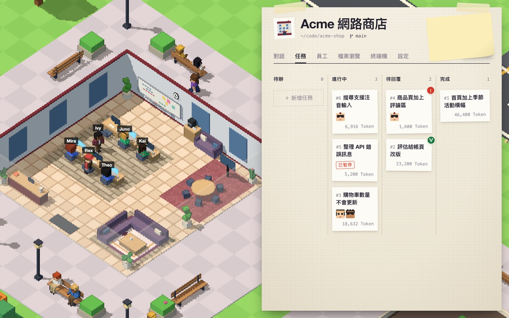

<p align="center">
  <a href="."></a>
</p>

<p align="center">
  <a href="README.md"></a>
  <a href="README-tw.md"></a>
  <a href="README-cn.md"></a>
  <a href="README-ja.md"></a>
  <a href="README-ko.md"></a>
</p>

# Team Work

Team Work 是一款 macOS 应用，让一组 AI Agent 在你自己的项目里工作。每个项目是像素风小岛上的一家公司，公司的员工是 AI Agent，他们按照任务流程一步步完成工作，每个任务都在自己的 Git 分支上进行，最后由你审核并合并。



## 功能

- **公司**：一个项目文件夹加一个目标分支就是一家公司。公司完成的任务越多、员工越多，大楼就越大。
- **员工**：由蓝图（Prompt、技能和允许的工具）生成，每位员工各自选择模型和思考等级。内置 16 个蓝图，例如后端工程师、代码审查员、技术文档写手。
- **任务流程**：任务要经过的步骤，从“整理需求”开始，以“验收”结束。中间的步骤可以交给员工执行，也可以和你讨论。内置 6 条任务流程，例如功能开发、修 Bug、重构。
- **任务**：每个任务在自己的 Git work tree 和 `task/编号` 分支上进行。员工有问题时，任务会等待你回复；验收通过后，由你合并回目标分支或退回重做。
- **对话**：在项目文件夹里和员工聊天。输入 `$` 选择技能，输入 `#` 提及文件。选择多位员工或用 `@` 提及员工，就能开会。
- **模型供应商**：Anthropic、OpenAI、Google Gemini 以及任何 OpenAI 兼容 API，也可以用 Claude 或 ChatGPT 订阅登录。
- **技能**：蓝图可以从本地文件夹或 GitHub 仓库加载技能。
- **终端**：每家公司都有一个在项目文件夹中打开的 zsh 终端。
- **语言**：繁体中文和英文。

## 安装

1. 从 [Releases](https://github.com/yanun0323/Team-Work/releases) 下载 `Team-Work-macOS.zip`。
2. 解压后，把 `Team Work.app` 移到“应用程序”文件夹。

需要 macOS 12 或更高版本，支持 Apple Silicon 和 Intel。任务需要 Git，项目文件夹也必须是 Git 仓库。

## 快速上手

1. 在“机场 → 模型供应商”中至少添加一个供应商，员工才有模型可用。
2. 点击“＋ 新公司”，在地图上选好位置，再填写项目位置、名称和目标分支。
3. 在公司的“员工”标签页添加员工：选择一个蓝图和模型。
4. 在“任务”标签页创建任务：写下要做的事，选择任务流程，再为每一步选择员工。
5. 打开任务查看“进度”，带红色感叹号的步骤正在等你回复。

右上角的问号会打开完整的使用说明。

应用界面目前只有繁体中文和英文，上面带引号的名称是界面文字的简体译名。

## 数据与安全

- 数据保存在 `~/.team-work`。如需改用其他文件夹，把 `TEAM_WORK_HOME` 设为绝对路径。
- API Key 和登录凭据保存在 `data.db`，文件权限为 `0600`，没有加密。
- 执行命令没有沙盒，只在信任的蓝图中允许“执行命令”工具。

## 从源码构建

需要 Go（版本见 `backend/go.mod`）、Node.js 和 npm，以及 Xcode 命令行工具。

```sh
make dev           # 同时启动后端和前端，地址为 http://localhost:5173
make dev-mock      # 只启动前端，使用模拟数据
make test-backend  # 后端测试
make build         # 构建 dist/Team Work.app（未签名）
```

运行 `make help` 可列出所有命令。[后端说明](backend/README.md)和[前端说明](frontend/README.md)为繁体中文。

## 许可证

[Apache License 2.0](LICENSE)
