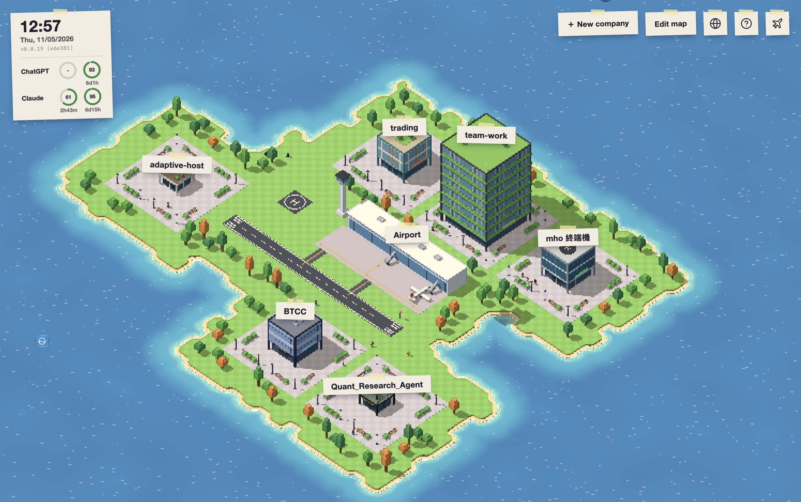

<p align="center">
  <a href="."></a>
</p>

<p align="center">
  <a href="README.md"></a>
  <a href="README-tw.md"></a>
  <a href="README-cn.md"></a>
  <a href="README-ja.md"></a>
  <a href="README-ko.md"></a>
</p>

# Team Work

Team Work は、AI の社員チームにあなた自身のプロジェクトで働いてもらう Mac アプリです。プロジェクトはそれぞれ、ピクセルアートの小さな島に建つ一つの会社です。社員を雇ってタスクを任せると、一歩ずつ仕上げていきます。タスクはそれぞれ専用の Git ブランチで進むので、あなたが確認してマージするまで、コードには何も入りません。



## 主な特長

- **一つのプロジェクトが一つの会社**：会社ごとに社員、タスク、ルール、メモリがあり、プロジェクト同士が混ざりません。
- **専門を持つ社員**：社員はブループリントに沿って働きます。ブループリントには一つの仕事に必要な指示、スキル、ツールがまとまっていて、モデルはあなたが選びます。すぐ使えるブループリントが 12 種類あります。
- **複数の社員と一つのチャットで**：違うモデルの社員を同じチャットに呼んで、アイデアを一緒に詰められます。最後に返信した社員は、次の作業を同僚に任せられます。
- **サブスクリプションを使える**：ChatGPT や Claude のサブスクリプションでサインインすれば従量課金は不要で、残量もひと目でわかります。
- **スキル、ブループリント、ワークフローを GitHub から**：GitHub リポジトリを貼るだけで中身が使え、ファイルをコピーする必要はありません。リポジトリが更新されたらワンクリックで適用でき、自動更新にもできます。Matt Pocock のスキルと poteto の pstack はすぐ使えます。
- **アプリの操作を社員に任せられる**：チャットで頼めば、社員がタスク、ブループリント、ワークフロー、モデルプロバイダーを用意します。既存の設定を変えるときは、あなたの承認を待ちます。
- **トークンを節約**：社員はスキルを必要なときだけ読み、長いチャットは自動で要約され、ステップ間は短い引き継ぎで仕事を渡し、プロバイダーが対応していれば繰り返すプロンプトはキャッシュされます。

## 機能

- **会社**：プロジェクトフォルダー一つと対象ブランチ（完成した作業のマージ先）一つで一つの会社です。タスクを終えて社員が増えるほど、建物が大きくなります。
- **社員**：ブループリント、モデル、思考レベルを選びます。ブループリントを使わず、設定を自分で書くこともできます。公式ブループリント 12 種類は、ジェネラリスト、機能プランナー、汎用エンジニア、リサーチャー、ライター、メディアデザイナー、UI デザインエンジニア、レビュー・QA、フロントエンドエンジニア、バックエンドエンジニア、SRE エンジニア、Poteto です。汎用エンジニアは Matt Pocock の、Poteto は poteto のスキルに沿って働きます。あるモデルを使っている社員をまとめて切り替えたいときは、設定でそのモデルを選び、新しいモデルを選ぶだけです。
- **ワークフロー**：タスクが通るステップで、要件の整理から最後の検収まで続きます。各ステップは、社員一人に任せる作業か、あなたとの話し合いのどちらかです。一般的なタスク、機能開発、バグ修正、コードレビューの 4 本がすぐ使えます。これらと公式ブループリントは [Team-Work-Source](https://github.com/yanun0323/Team-Work-Source) にあり、初回にダウンロードされ、その後は自動で最新に保たれます。
- **タスク**：タスクはそれぞれプロジェクトの専用コピーと `task/<番号>` ブランチで進みます。社員に質問があると、タスクはあなたの返事を待ちます。終わったらマージするか差し戻すかを選びます。コミットにはあなた自身の Git の名前とメールアドレスが使われます。タスクの責任者は、タスクのチャットで 1〜6 人の社員と会議を開けます。あなたはいつでも口を挟め、`@` で人を呼び込めます。
  - 新しいタスクはすぐ動かせます：コピーには Git が無視するファイル（`.env` やローカル設定など）も入り、ロックファイルのある Node プロジェクト（npm、pnpm、Yarn）は作業前にパッケージがインストールされます。Node とそのパッケージマネージャーは事前にインストールしておく必要があります。コピーされた `.env` は、同じデータベースやサービスにつながったままです。
- **チャット**：プロジェクトフォルダーで社員と話します。`$` でスキルを選び、`#` でファイルに触れ、`@` で別の社員を呼びます。社員が開いた画像はチャットにも表示されます。
- **メモリ**：会社のメモリには、そのプロジェクトの決まりごとやハマりどころが残り、そこで働く全員が共有します。会社の「メモリ」タブで編集できます。社員にはそれぞれ自分の仕事の進め方を覚えておく個人のメモリもあり、どの会社に行っても一緒です。
- **入国管理局**：空港の隣にある建物で、島全体で共有する社員がいます。どの会社でも、その会社のフォルダーとルールで働いてもらえます。
- **基地局**：自分の他の Mac とペアリングして、お互いの島を訪ねられます。フレンドの島ごとに「開放しない」「閲覧のみ」「操作可」を選べます。作業は相手の Mac で動くので、そちらでは Team Work を開いたままにしておく必要があります。[Tailcat](https://github.com/tailscale/tailcat/) を内蔵しているので、Tailscale アカウントや追加のインストールは不要です。標準の無料リレーには通信量の制限があります。
- **投影した会社**：フレンドの島の会社を自分の島に置き、移動せずにその場で開けます。作業はこれまでどおりフレンドの Mac で動きます。
- **島の名所**：Team Work を使うほど、島に公共の施設が自然にできます。公園、展望台のある丘、湖になる噴水、海辺のボートの泊まる桟橋、時計塔。島の人たちが座ったり、ピクニックをしたり、眺めたり、水を見たり、桟橋で釣りをしたりします。プロフィールの「島の名所」で、各段階の条件がわかります。
- **モデルプロバイダー**：Anthropic、OpenAI、Google Gemini、OpenAI 互換の任意のサービス（DeepSeek やローカルの Ollama など）を API キーで使えるほか、Claude や ChatGPT のサブスクリプションでサインインできます。Claude のサブスクリプションは Claude Code 経由で動き、入っていなければアプリがインストールを提案します。
- **MCP とフック**：`~/.team-work/mcp.json` に MCP サーバーを書くと社員のツールが増え、`~/.team-work/hooks.json` で社員の作業中に自分のコマンドを実行できます。どちらも Claude Code の形式なので、設定をそのまま移せます。
- **画像生成**：「設定 → システム → 画像生成」で ChatGPT のサブスクリプションか OpenAI 互換プロバイダーの画像モデルを選ぶと、社員が画像を作れます。
- **セマンティック検索（試験運用）**：社員が、言葉の一致だけでなくコードが何をしているかで探せます。Mac の中で動き、Apple シリコンの macOS 27 が必要です。初期状態はオフで、設定でオンにします。
- **ターミナルとファイル**：会社ごとにプロジェクトフォルダーで開くターミナルがあり、空港にはホームフォルダーで開くものがあるので、アプリを離れずに Codex や Claude Code を使えます。プロジェクトの閲覧、テキストファイルの編集、画像のプレビューもできます。
- **島にいるあなた**：自分のキャラクターを作り、使った記録を見て、W・A・S・D で島を歩き回れます。ウィンドウを閉じても、アプリはメニューバーで動き続けます。
- **言語**：繁体字中国語、簡体字中国語、英語、日本語、韓国語。

## インストール

1. [Releases](https://github.com/yanun0323/Team-Work/releases) から `Team-Work-macOS.zip` をダウンロードします。
2. 解凍して、`Team Work.app` を「アプリケーション」フォルダーに移します。

macOS 13.3 以降が必要で、Apple シリコンと Intel のどちらでも動きます。Git も必要です。Mac に入っていなければ、アプリが Git を含む Apple の Command Line Tools のインストールを提案します。プロジェクトフォルダーがまだ Git リポジトリでなければ、会社を作るときに Git リポジトリになります。アプリは自動でアップデートされます。

## はじめかた

1. 「空港 → モデルプロバイダー」でプロバイダーを一つ以上追加して、社員が使えるモデルを用意します。
2. 「＋ 新しい会社」を押して地図上の場所を選び、プロジェクトフォルダー、名前、対象ブランチを入力します。
3. 会社の「社員」タブで社員を追加します。ブループリントとモデルを選びます。
4. 「タスク」タブでタスクを作ります。やることを書き、ワークフローを選び、各ステップの担当を決めます。
5. タスクを開いて「進捗」を見ます。赤い感嘆符のついたステップがあなたを待っています。

右上の疑問符から、詳しい使い方を開けます。

## データとセキュリティ

- データはすべて `~/.team-work` に保存されます。別のフォルダーを使うには、`TEAM_WORK_HOME` に絶対パスを設定します。
- API キーとサインイン情報は `data.db` に保存され、あなたのユーザーアカウントだけが読めます（`0600`）。暗号化はされていません。
- コマンドを実行できる社員はコンピューター全体に触れられます。サンドボックスはありません。このツールは信頼できるブループリントにだけ許可してください。

## ソースからビルド

Go（バージョンは `backend/go.mod` を参照）、Node.js と npm、Xcode のコマンドラインツールが必要です。

```sh
make dev           # バックエンドとフロントエンドを同時に起動（http://localhost:5173）
make dev-mock      # フロントエンドだけを仮のデータで起動
make test-backend  # バックエンドのテスト
make build         # dist/Team Work.app をビルド（未署名）
```

`make help` ですべてのコマンドを表示できます。[バックエンド](backend/README.md)と[フロントエンド](frontend/README.md)の説明は繁体字中国語です。

## ライセンス

[Apache License 2.0](LICENSE)
