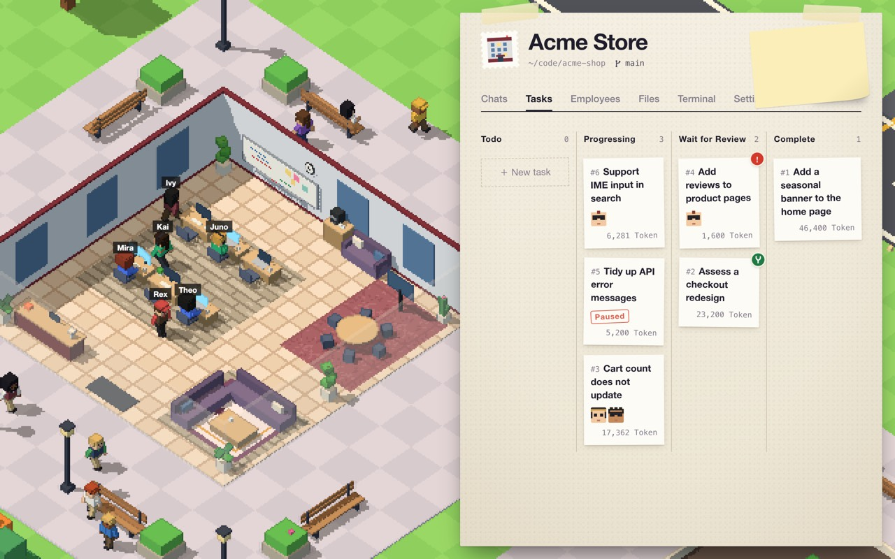

<p align="center">
  <a href="."></a>
</p>

<p align="center">
  <a href="README.md"></a>
  <a href="README-tw.md"></a>
  <a href="README-cn.md"></a>
  <a href="README-ja.md"></a>
  <a href="README-ko.md"></a>
</p>

# Team Work

Team Work は、AI エージェントのチームを自分のプロジェクトで働かせる macOS アプリです。プロジェクトはそれぞれ、ピクセルアートの島に建つ会社になります。社員は AI エージェントで、ワークフローに沿って一歩ずつ作業を進めます。タスクごとに専用の Git ブランチで作業し、結果はあなたがレビューしてマージします。



## 機能

- **会社**：プロジェクトフォルダーとターゲットブランチの組み合わせが一つの会社です。完了したタスクと社員が増えるほど、ビルが大きくなります。
- **社員**：ブループリント（プロンプト、スキル、許可するツール）から作成します。モデルと思考レベルは社員ごとに選べます。Backend Engineer、Code Reviewer、Technical Writer など 16 種類のブループリントが組み込まれています。
- **ワークフロー**：タスクがたどるステップです。Clarify requirements で始まり、Acceptance review で終わります。途中のステップでは、社員に作業を任せるか、あなたと話し合うかを選べます。Feature development、Bug fix、Refactor など 6 種類が組み込まれています。
- **タスク**：タスクごとに専用の Git worktree と `task/<番号>` ブランチで作業します。社員から質問があると、タスクはあなたの返信を待ちます。レビューを通過したら、ターゲットブランチにマージするか差し戻します。
- **チャット**：プロジェクトフォルダーで社員と会話できます。`$` でスキルを選び、`#` でファイルを指定します。複数の社員を選ぶか `@` でメンションすると会議になります。
- **モデルプロバイダー**：Anthropic、OpenAI、Google Gemini、OpenAI 互換の API に対応しています。Claude や ChatGPT のサブスクリプションでもサインインできます。
- **スキル**：ブループリントはローカルフォルダーや GitHub リポジトリからスキルを読み込みます。
- **ターミナル**：会社ごとに、プロジェクトフォルダーで開く zsh ターミナルがあります。
- **言語**：繁体字中国語と英語。

## インストール

1. [Releases](https://github.com/yanun0323/Team-Work/releases) から `Team-Work-macOS.zip` をダウンロードします。
2. 解凍して、`Team Work.app` をアプリケーションフォルダーに移動します。

macOS 12 以降が必要で、Apple Silicon と Intel に対応しています。タスクには Git が必要で、プロジェクトフォルダーは Git リポジトリでなければなりません。

## はじめかた

1. Airport → Model providers でプロバイダーを一つ以上追加し、社員が使えるモデルを用意します。
2. ＋ New company を押して地図上の場所を選び、プロジェクトフォルダー、名前、ターゲットブランチを入力します。
3. 会社の Employees タブで社員を追加します。ブループリントとモデルを選びます。
4. Tasks タブでタスクを作成します。作業内容を書き、ワークフローを選び、ステップごとに担当の社員を選びます。
5. タスクを開いて Progress を確認します。赤い感嘆符が付いたステップは、あなたの返信を待っています。

右上の疑問符を押すと、詳しいガイドが開きます。

アプリの表示言語は繁体字中国語と英語のみです。上記の項目名は英語表示のものです。

## データとセキュリティ

- データは `~/.team-work` に保存されます。別のフォルダーを使うには、`TEAM_WORK_HOME` に絶対パスを設定します。
- API キーとサインイン情報は `data.db` に保存され、ファイル権限は `0600` です。暗号化はされていません。
- コマンドの実行にはサンドボックスがありません。コマンド実行ツールは、信頼できるブループリントでのみ許可してください。

## ソースからビルド

Go（バージョンは `backend/go.mod` を参照）、Node.js と npm、Xcode コマンドラインツールが必要です。

```sh
make dev           # バックエンドとフロントエンドを起動（http://localhost:5173）
make dev-mock      # フロントエンドのみ、模擬データで起動
make test-backend  # バックエンドのテスト
make build         # dist/Team Work.app をビルド（未署名）
```

`make help` ですべてのコマンドを表示できます。[バックエンド](backend/README.md)と[フロントエンド](frontend/README.md)の説明は繁体字中国語です。

## ライセンス

[Apache License 2.0](LICENSE)
