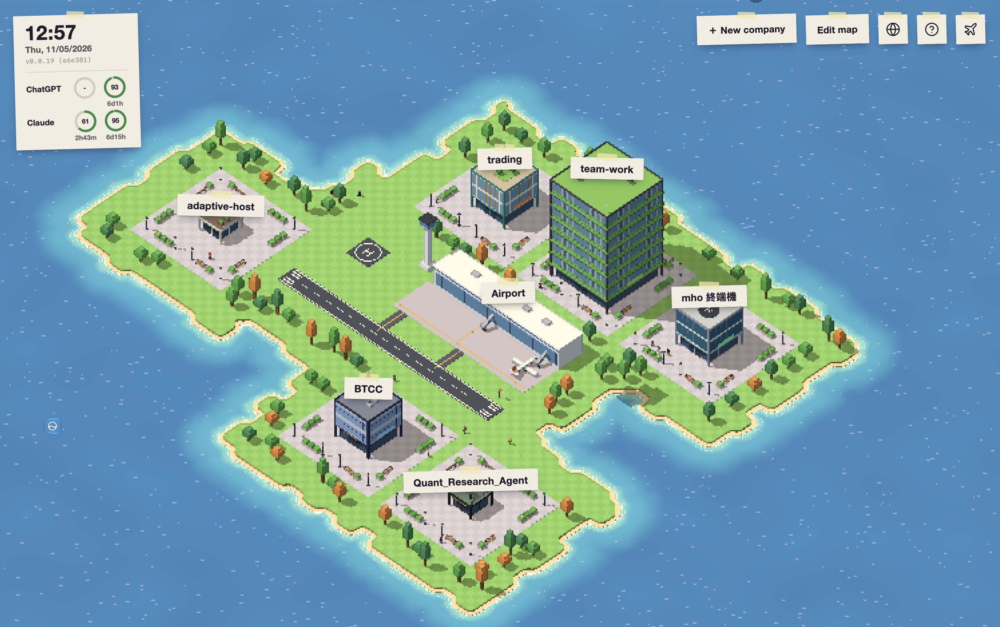

<p align="center">
  <a href="."></a>
</p>

<p align="center">
  <a href="README.md"></a>
  <a href="README-tw.md"></a>
  <a href="README-cn.md"></a>
  <a href="README-ja.md"></a>
  <a href="README-ko.md"></a>
</p>

# Team Work

Team Work는 AI 직원 팀이 여러분의 프로젝트에서 일하게 해 주는 Mac 앱입니다. 프로젝트 하나는 픽셀 아트 작은 섬 위의 회사 하나입니다. 직원을 고용하고 작업을 맡기면 한 단계씩 해냅니다. 작업마다 자기 Git 브랜치에서 진행되므로, 여러분이 확인하고 병합하기 전까지 코드에는 아무것도 들어가지 않습니다.



## 주요 특징

- **프로젝트 하나가 회사 하나**: 회사마다 직원, 작업, 규칙, 메모리가 따로 있어 프로젝트끼리 섞이지 않습니다.
- **전문 분야가 있는 직원**: 직원은 블루프린트를 따라 일합니다. 블루프린트에는 한 가지 일에 필요한 지시, 스킬, 도구가 담겨 있고 모델은 여러분이 고릅니다. 바로 쓸 수 있는 블루프린트가 12개 있습니다.
- **여러 직원과 한 채팅에서**: 다른 모델을 쓰는 직원들을 한 채팅에 불러 아이디어를 함께 다듬을 수 있습니다. 마지막으로 답한 직원은 다음 단계를 동료에게 넘길 수 있습니다.
- **구독을 그대로 사용**: ChatGPT나 Claude 구독으로 로그인하면 사용량만큼 따로 낼 필요가 없고, 남은 양도 한눈에 보입니다.
- **스킬, 블루프린트, 워크플로를 GitHub에서**: GitHub 저장소를 붙여 넣기만 하면 안의 내용을 쓸 수 있고 파일을 복사할 필요가 없습니다. 저장소가 바뀌면 클릭 한 번으로 적용하거나 자동으로 업데이트되게 할 수 있습니다. Matt Pocock의 스킬과 poteto의 pstack을 바로 쓸 수 있습니다.
- **앱 일을 직원에게 맡기기**: 채팅에서 부탁하면 직원이 작업, 블루프린트, 워크플로, 모델 공급자를 만들어 줍니다. 기존 설정을 바꿀 때는 여러분의 승인을 기다립니다.
- **토큰 절약**: 직원은 필요할 때만 스킬을 읽고, 긴 채팅은 자동으로 요약되며, 단계 사이에는 짧은 인계로 일을 넘기고, 공급자가 지원하면 반복되는 프롬프트는 캐시됩니다.

## 기능

- **회사**: 프로젝트 폴더 하나와 대상 브랜치(끝난 작업이 병합되는 곳) 하나가 회사 하나입니다. 작업을 끝내고 직원이 늘수록 건물이 커집니다.
- **직원**: 블루프린트, 모델, 생각 수준을 고릅니다. 블루프린트 없이 설정을 직접 쓸 수도 있습니다. 공식 블루프린트 12개는 제너럴리스트, 기능 플래너, 범용 엔지니어, 리서처, 라이터, 미디어 디자이너, UI 디자인 엔지니어, 리뷰·QA, 프런트엔드 엔지니어, 백엔드 엔지니어, SRE 엔지니어, Poteto입니다. 범용 엔지니어는 Matt Pocock의 스킬로, Poteto는 poteto의 스킬로 일합니다. 어떤 모델을 쓰는 직원을 한꺼번에 바꾸려면 설정에서 그 모델을 고르고 새 모델을 선택하면 됩니다.
- **워크플로**: 작업이 거치는 단계로, 요구 사항 정리부터 마지막 검수까지 이어집니다. 각 단계는 직원 한 명에게 맡기는 일이거나 여러분과의 논의입니다. 일반 작업, 기능 개발, 버그 수정, 코드 리뷰 4개를 바로 쓸 수 있습니다. 이들과 공식 블루프린트는 [Team-Work-Source](https://github.com/yanun0323/Team-Work-Source)에 있으며, 처음 쓸 때 내려받고 이후 자동으로 최신 상태를 유지합니다.
- **작업**: 작업마다 프로젝트의 전용 사본과 `task/<번호>` 브랜치에서 진행됩니다. 직원에게 질문이 생기면 작업은 여러분의 답을 기다립니다. 끝나면 병합하거나 되돌려 보냅니다. 커밋에는 여러분의 Git 이름과 이메일이 쓰입니다. 작업 담당자는 작업 채팅에서 바로 직원 1~6명과 회의를 열 수 있고, 여러분은 언제든 끼어들어 `@`로 사람을 불러올 수 있습니다.
  - 새 작업은 바로 실행할 수 있습니다: 사본에는 Git이 무시하는 파일(`.env`, 로컬 설정 등)도 들어가고, 잠금 파일이 있는 Node 프로젝트(npm, pnpm, Yarn)는 작업 전에 패키지가 설치됩니다. Node와 해당 패키지 관리자는 미리 설치되어 있어야 합니다. 복사된 `.env`는 여전히 같은 데이터베이스와 서비스에 연결됩니다.
- **채팅**: 프로젝트 폴더에서 직원과 이야기합니다. `$`로 스킬을 고르고, `#`로 파일을 언급하고, `@`로 다른 직원을 부릅니다. 직원이 연 이미지는 채팅에도 보입니다.
- **메모리**: 회사 메모리에는 그 프로젝트의 관례와 주의할 점이 남고, 그곳에서 일하는 모두가 함께 씁니다. 회사의 「메모리」 탭에서 고칠 수 있습니다. 직원마다 자기 일하는 방식을 기억하는 개인 메모리도 있어 어느 회사에 가든 함께 갑니다.
- **이민국**: 공항 옆 건물로, 섬 전체가 함께 쓰는 직원이 있습니다. 어느 회사든 그 회사의 폴더와 규칙으로 이들에게 일을 맡길 수 있습니다.
- **기지국**: 내 다른 Mac과 페어링해 서로의 섬을 방문합니다. 친구 섬마다 「개방 안 함」, 「보기만」, 「조작 가능」을 고를 수 있습니다. 작업은 상대 Mac에서 돌아가므로, 그쪽은 Team Work를 켜 두어야 합니다. [Tailcat](https://github.com/tailscale/tailcat/)이 내장되어 있어 Tailscale 계정이나 추가 설치가 필요 없습니다. 기본 무료 릴레이에는 트래픽 제한이 있습니다.
- **투영한 회사**: 친구 섬의 회사를 내 섬에 두고, 이동하지 않고 바로 엽니다. 일은 여전히 친구의 Mac에서 돌아갑니다.
- **섬의 명소**: Team Work를 쓸수록 섬에 공공시설이 저절로 생깁니다. 공원, 전망대가 있는 언덕, 호수가 되는 분수, 바닷가에 보트가 정박한 부두, 시계탑. 섬 사람들이 앉아 쉬고, 소풍을 즐기고, 경치와 물을 바라보고, 부두에서 낚시를 합니다. 프로필의 「섬의 명소」에서 단계마다 조건을 볼 수 있습니다.
- **모델 공급자**: Anthropic, OpenAI, Google Gemini, OpenAI 호환 서비스(DeepSeek, 로컬 Ollama 등)를 API 키로 쓰거나, Claude나 ChatGPT 구독으로 로그인할 수 있습니다. Claude 구독은 Claude Code를 통해 동작하며, 없으면 앱이 설치를 제안합니다.
- **MCP와 훅**: `~/.team-work/mcp.json`에 MCP 서버를 적으면 직원의 도구가 늘어나고, `~/.team-work/hooks.json`으로 직원이 일하는 동안 내 명령을 실행할 수 있습니다. 둘 다 Claude Code 형식이라 설정을 그대로 옮길 수 있습니다.
- **이미지 생성**: 「설정 → 시스템 → 이미지 생성」에서 ChatGPT 구독이나 OpenAI 호환 공급자의 이미지 모델을 고르면 직원이 그림을 만들 수 있습니다.
- **시맨틱 검색(실험 기능)**: 직원이 글자 일치뿐 아니라 코드가 하는 일로도 찾을 수 있습니다. Mac 안에서 동작하고, Apple 실리콘의 macOS 27이 필요하며, 기본은 꺼져 있어 설정에서 켜야 합니다.
- **터미널과 파일**: 회사마다 프로젝트 폴더에서 열리는 터미널이 있고, 공항에는 홈 폴더에서 열리는 터미널이 있어 앱을 떠나지 않고 Codex나 Claude Code를 쓸 수 있습니다. 프로젝트를 둘러보고, 텍스트 파일을 편집하고, 이미지를 미리 볼 수도 있습니다.
- **섬 위의 나**: 내 캐릭터를 만들고, 사용 기록을 보고, W·A·S·D로 섬을 걸어 다닐 수 있습니다. 창을 닫아도 앱은 메뉴 막대에서 계속 실행됩니다.
- **언어**: 번체 중국어, 간체 중국어, 영어, 일본어, 한국어.

## 설치

1. [Releases](https://github.com/yanun0323/Team-Work/releases)에서 `Team-Work-macOS.zip`을 내려받습니다.
2. 압축을 풀고 `Team Work.app`을 「응용 프로그램」 폴더로 옮깁니다.

macOS 13.3 이상이 필요하며 Apple 실리콘과 Intel 모두에서 동작합니다. Git도 필요합니다. Mac에 없으면 앱이 Git이 들어 있는 Apple의 Command Line Tools 설치를 제안합니다. 프로젝트 폴더가 아직 Git 저장소가 아니면 회사를 만들 때 Git 저장소가 됩니다. 앱은 스스로 업데이트됩니다.

## 시작하기

1. 「공항 → 모델 공급자」에서 공급자를 하나 이상 추가해 직원이 쓸 모델을 준비합니다.
2. 「＋ 새 회사」를 누르고 지도에서 자리를 고른 다음 프로젝트 폴더, 이름, 대상 브랜치를 입력합니다.
3. 회사의 「직원」 탭에서 직원을 추가합니다. 블루프린트와 모델을 고릅니다.
4. 「작업」 탭에서 작업을 만듭니다. 할 일을 적고, 워크플로를 고르고, 단계마다 맡을 사람을 정합니다.
5. 작업을 열고 「진행 상황」을 봅니다. 빨간 느낌표가 붙은 단계가 여러분을 기다리고 있습니다.

오른쪽 위 물음표를 누르면 전체 안내서가 열립니다.

## 데이터와 보안

- 모든 데이터는 `~/.team-work`에 저장됩니다. 다른 폴더를 쓰려면 `TEAM_WORK_HOME`을 절대 경로로 설정하세요.
- API 키와 로그인 정보는 `data.db`에 저장되며, 내 사용자 계정만 읽을 수 있습니다(`0600`). 암호화되지는 않습니다.
- 명령을 실행할 수 있는 직원은 컴퓨터 전체에 접근할 수 있습니다. 샌드박스가 없습니다. 이 도구는 믿을 수 있는 블루프린트에만 허용하세요.

## 소스에서 빌드

Go(버전은 `backend/go.mod` 참고), Node.js와 npm, Xcode 명령줄 도구가 필요합니다.

```sh
make dev           # 백엔드와 프런트엔드를 함께 실행 (http://localhost:5173)
make dev-mock      # 가짜 데이터로 프런트엔드만 실행
make test-backend  # 백엔드 테스트
make build         # dist/Team Work.app 빌드 (서명 없음)
```

`make help`로 모든 명령을 볼 수 있습니다. [백엔드](backend/README.md)와 [프런트엔드](frontend/README.md) 설명은 번체 중국어로 되어 있습니다.

## 라이선스

[Apache License 2.0](LICENSE)
