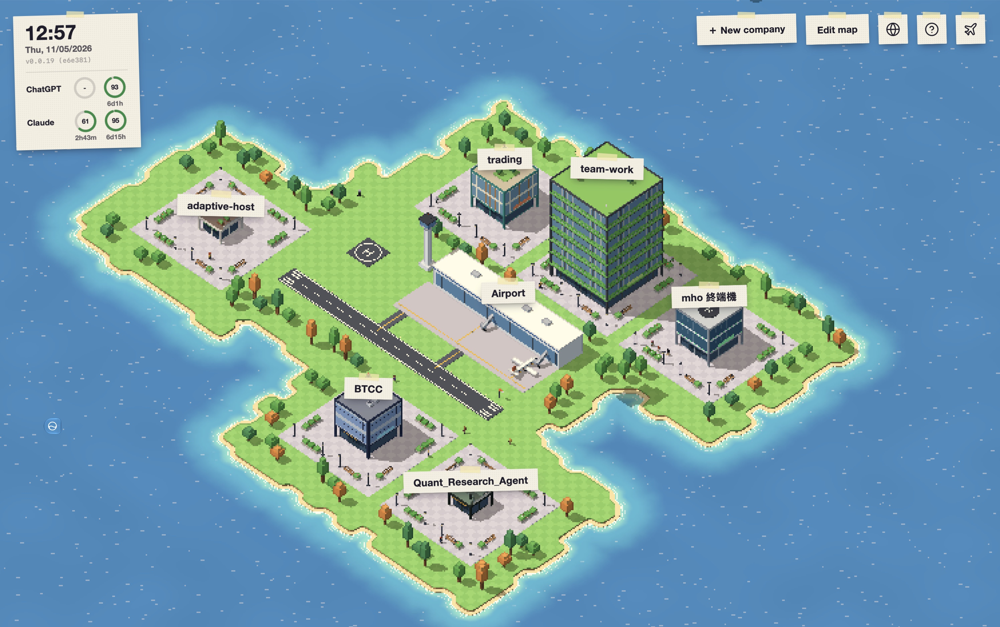

<p align="center">
  <a href="."></a>
</p>

<p align="center">
  <a href="README.md"></a>
  <a href="README-tw.md"></a>
  <a href="README-cn.md"></a>
  <a href="README-ja.md"></a>
  <a href="README-ko.md"></a>
</p>

# Team Work

Team Work는 AI 에이전트 팀이 내 프로젝트에서 일하게 해 주는 macOS 앱입니다. 각 프로젝트는 픽셀 아트 섬 위의 건물 하나, 즉 회사가 됩니다. 직원은 AI 에이전트로, 워크플로를 따라 한 단계씩 작업합니다. 각 작업은 자기만의 Git 브랜치에서 진행되고, 결과는 사용자가 검토한 뒤 병합합니다.



## 주요 특징

- **GitHub에서 스킬 자동 업데이트**: GitHub 저장소 주소만 붙여 넣으면 그 안의 스킬을 바로 쓸 수 있습니다. 파일을 하나씩 복사할 필요가 없습니다. 저장소에 새 버전이 나오면 한 번 클릭으로 적용하거나, 자동 적용을 켤 수 있습니다. Matt Pocock의 스킬과 poteto의 pstack을 바로 쓸 수 있습니다.
- **프로젝트 하나가 회사 하나**: 회사마다 자기 설정, 직원, 작업이 있어서 프로젝트끼리 섞이지 않습니다.
- **전문 분야가 있는 직원**: 직원마다 스킬, 프롬프트, 사용 도구, 모델을 따로 정해 각 역할이 자기 일에 집중하게 합니다.
- **여러 직원과 한 채팅에서**: 모델도 전문 분야도 다른 직원들을 같은 채팅에 불러 요구사항을 함께 논의하고, 바꾸고, 만듭니다.
- **앱 기능을 AI에게 맡기기**: 채팅에서 직원에게 부탁하면 작업, 블루프린트, 워크플로, 모델 제공자를 만들거나 바꿔 줍니다. 블루프린트와 제공자 변경은 사용자의 승인을 기다립니다. 직원은 앱 안의 터미널도 읽을 수 있습니다.
- **앱 안에 터미널**: 앱을 떠나지 않고 Codex나 Claude Code를 쓸 수 있습니다.
- **GPT와 Claude 구독 지원**: ChatGPT 또는 Claude 구독으로 로그인하고, 남은 사용량도 바로 확인할 수 있습니다.
- **토큰 절약**: 직원은 평소 스킬 목록만 보고 필요할 때 전체 내용을 읽습니다. 긴 채팅은 앞부분을 자동으로 요약하고, 단계 사이에는 짧은 인계로 작업을 넘깁니다. 제공자가 지원하면 반복되는 프롬프트는 캐시됩니다.

## 앞으로 추가될 기능

다른 사람이 GitHub에 공유한 것을 불러오고 업데이트하기:

- [x] 스킬
- [ ] 블루프린트
- [ ] 워크플로

## 기능

- **송전탑**: 내장된 [Tailcat](https://github.com/tailscale/tailcat/)으로 자신의 컴퓨터를 페어링하고 상대 컴퓨터의 섬으로 이동합니다. 최초 페어링은 승인이 필요하며, 각 컴퓨터가 조작 허용 여부를 따로 설정합니다. 작업과 설정은 상대 컴퓨터에 있고, 조작하는 앱이 연결을 끊어도 작업은 계속됩니다. **조작되는 컴퓨터에서는 Team Work를 계속 실행해야 합니다.** Tailscale 계정이나 별도 설치는 필요 없으며, 기본 무료 중계 서버에는 트래픽 제한이 있습니다.
- **회사**: 프로젝트 폴더 하나와 대상 브랜치 하나가 회사 하나입니다. 완료한 작업과 직원이 늘수록 건물이 커집니다.
- **직원**: 블루프린트(프롬프트, 스킬, 허용 도구)로 만듭니다. 모델과 사고 수준은 직원마다 고를 수 있습니다. 블루프린트 없이 프롬프트, 스킬, 도구를 직원별로 직접 설정하거나, 블루프린트를 복사해 조정할 수도 있습니다. Backend Engineer, Review & QA, Media Designer 등 13가지 블루프린트가 기본으로 들어 있으며, GitHub에 공개된 스킬로 일하는 Matt Pocock과 Poteto도 있습니다.
- **워크플로**: 작업이 거치는 단계로, Clarify requirements에서 시작해 Acceptance review로 끝납니다. 중간 단계는 직원에게 작업을 맡기거나 사용자와 논의하게 할 수 있습니다. General task, Feature development, Bug fix, Code review 4가지를 바로 쓸 수 있습니다. 이것들과 미리 만들어 둔 블루프린트는 공식 소스 [Team-Work-Source](https://github.com/yanun0323/Team-Work-Source)에 있으며, 처음 쓸 때 내려받고 그 뒤로 알아서 업데이트됩니다.
- **작업**: 작업마다 자기만의 Git worktree와 `task/<번호>` 브랜치에서 진행됩니다. 직원에게 질문이 생기면 작업은 사용자의 답변을 기다립니다. 검토를 통과하면 대상 브랜치에 병합하거나 다시 돌려보냅니다.
  - 작업 단계 전에 잠금 파일이 있는 npm／pnpm／Yarn 프로젝트의 의존성을 자동으로 준비합니다. 설정이 일치하고 원본 폴더에 연결되지 않은 npm 환경은 작업 worktree로 복사하며, 가능하면 APFS 복제를 사용합니다. 그 외에는 잠금 파일을 고정하여 설치하고 일반 설치 스크립트도 실행합니다. 다음 단계는 환경을 재사용하며 패키지 설정이 바뀌면 다시 준비합니다. Node와 해당 패키지 관리자는 미리 설치되어 있어야 합니다. 진행 상황은 작업 기록에 표시되며, 준비 실패 시 작업과 검증을 시작하지 않고 재시도를 기다립니다. `.worktreeinclude`는 필요 없습니다. `.env`, 기타 개인 파일과 다른 언어 환경은 복사하지 않습니다. 패키지 결과물은 작업 브랜치에서 Git 무시 대상이어야 합니다.
- **채팅**: 프로젝트 폴더에서 직원과 대화합니다. `$`로 스킬을 고르고 `#`로 파일을 언급합니다. 여러 직원을 고르거나 `@`로 언급하면 회의가 됩니다.
- **모델 제공자**: Anthropic, OpenAI, Google Gemini, 그리고 OpenAI 호환 API를 지원합니다. Claude 또는 ChatGPT 구독으로 로그인할 수도 있습니다.
- **스킬**: 블루프린트는 로컬 폴더나 GitHub 저장소에서 스킬을 불러옵니다.
- **터미널**: 회사마다 프로젝트 폴더에서 열리는 zsh 터미널이 있고, 공항에도 홈 폴더에서 열리는 터미널이 있습니다.
- **파일**: 회사의 프로젝트 폴더를 둘러보고, 텍스트 파일을 편집하고, 이미지를 미리 볼 수 있습니다.
- **언어**: 번체 중국어, 간체 중국어, 영어, 일본어, 한국어.

## 설치

1. [Releases](https://github.com/yanun0323/Team-Work/releases)에서 `Team-Work-macOS.zip`을 내려받습니다.
2. 압축을 풀고 `Team Work.app`을 응용 프로그램 폴더로 옮깁니다.

macOS 13.3 이상이 필요하며 Apple Silicon과 Intel을 지원합니다. 작업에는 Git이 필요하고, 프로젝트 폴더는 Git 저장소여야 합니다.

## 시작하기

1. 공항 → 모델 공급자에서 공급자를 하나 이상 추가해 직원이 사용할 모델을 준비합니다.
2. ＋ 새 회사를 누르고 지도에서 위치를 고른 뒤, 프로젝트 폴더, 이름, 대상 브랜치를 입력합니다.
3. 회사의 직원 탭에서 직원을 추가합니다. 블루프린트와 모델을 고릅니다.
4. 작업 탭에서 작업을 만듭니다. 할 일을 적고, 워크플로를 고르고, 단계마다 담당 직원을 고릅니다.
5. 작업을 열어 진행 상황을 확인합니다. 빨간 느낌표가 붙은 단계는 사용자의 답변을 기다리고 있습니다.

오른쪽 위의 물음표를 누르면 자세한 안내가 열립니다.

## 데이터와 보안

- 데이터는 `~/.team-work`에 저장됩니다. 다른 폴더를 쓰려면 `TEAM_WORK_HOME`에 절대 경로를 지정합니다.
- API 키와 로그인 정보는 `data.db`에 파일 권한 `0600`으로 저장되며, 암호화되지 않습니다.
- 명령 실행에는 샌드박스가 없습니다. 명령 실행 도구는 신뢰하는 블루프린트에서만 허용하세요.

## 소스에서 빌드

Go(버전은 `backend/go.mod` 참고), Node.js와 npm, Xcode 명령줄 도구가 필요합니다.

```sh
make dev           # 백엔드와 프런트엔드를 함께 실행 (http://localhost:5173)
make dev-mock      # 프런트엔드만, 모의 데이터로 실행
make test-backend  # 백엔드 테스트
make build         # dist/Team Work.app 빌드 (서명 안 됨)
```

`make help`로 모든 명령을 볼 수 있습니다. [백엔드](backend/README.md)와 [프런트엔드](frontend/README.md) 설명은 번체 중국어로 되어 있습니다.

## 라이선스

[Apache License 2.0](LICENSE)
