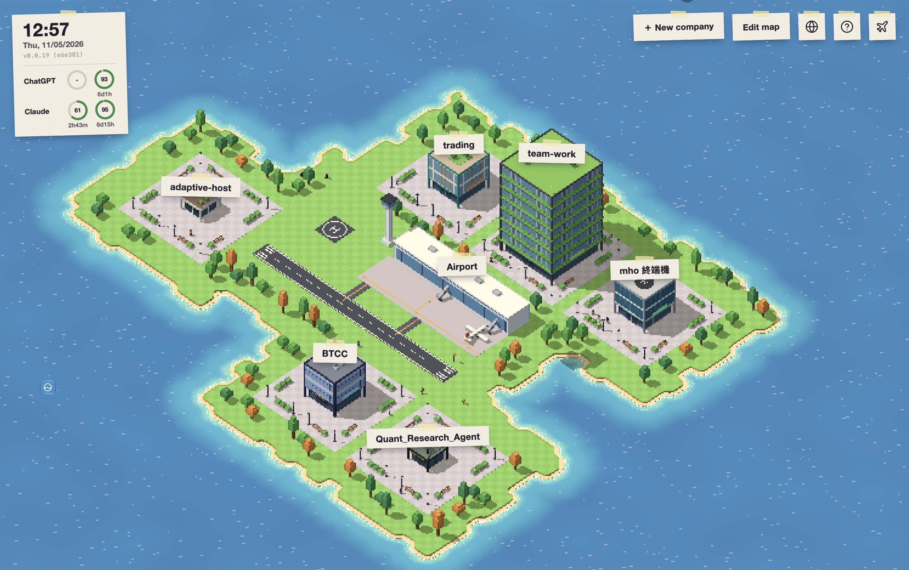

<p align="center">
  <a href="."></a>
</p>

<p align="center">
  <a href="README.md"></a>
  <a href="README-tw.md"></a>
  <a href="README-cn.md"></a>
  <a href="README-ja.md"></a>
  <a href="README-ko.md"></a>
</p>

# Team Work

Team Work 是一個 Mac App，讓一群 AI 員工在你自己的專案裡工作。每個專案是像素風小島上的一間公司。你雇用員工、交代任務，他們就一步步把事情做完。每個任務都在自己的 Git 分支上進行，你看過、合併之前，不會動到你的程式碼。



## 主打特色

- **一個專案就是一間公司**：每間公司有自己的員工、任務、規則和記憶，專案之間不會混在一起。
- **每位員工各有專長**：員工照著藍圖工作，藍圖寫好了一種工作需要的指示、技能和工具，模型由你挑。現成有 12 個藍圖。
- **多位員工一起對話**：把用不同模型的員工拉進同一個對話，一起把想法討論清楚。最後回話的人可以把下一步交給同事。
- **用你的訂閱**：用 ChatGPT 或 Claude 訂閱登入，不必按用量付費，還能一眼看到剩多少額度。
- **技能、藍圖和任務藍圖從 GitHub 來**：貼上 GitHub Repo 就能用裡面的東西，不用自己複製檔案。Repo 有更新時按一下就能套用，也可以讓它自己更新。直接就能用 Matt Pocock 的技能和 poteto 的 pstack。
- **App 的事可以交給員工**：在對話裡開口，員工就會幫你建立任務、藍圖、任務藍圖和模型供應商。要改既有的設定時，會先等你同意。
- **省 Token**：員工需要時才讀技能內容、長對話會自動摘要、步驟之間用簡短的交接傳遞工作，供應商支援時重複的 Prompt 會被快取。

## 功能

- **公司**：一個專案資料夾加一個目標分支（做完的工作合併回去的地方）就是一間公司。完成越多任務、員工越多，大樓就越大。
- **員工**：選藍圖、模型和思考等級，也可以不用藍圖，自己寫設定。12 個官方藍圖是通才、功能規劃、通用工程師、研究員、寫手、媒體設計師、介面設計工程師、審查與測試、前端工程師、後端工程師、SRE 工程師和 Poteto。通用工程師照 Matt Pocock 的技能工作，Poteto 照 poteto 的。想把用某個模型的人一次換掉，在「設定」選那個模型，再挑新的就好。
- **任務藍圖**：任務要經過的步驟，從整理需求到最後驗收。每一步不是交給一位員工做事，就是和你討論。現成有 4 條：一般任務、功能開發、修 Bug、程式審查。它們和官方藍圖都來自 [Team-Work-Source](https://github.com/yanun0323/Team-Work-Source)，第一次使用時下載，之後自動更新。
- **任務**：每個任務在自己的專案副本和 `task/編號` 分支上進行。員工有問題時，任務會停下來等你。做完後由你合併或退回。Commit 用的是你自己的 Git 名字和 Email。任務的負責人可以直接在任務對話裡找 1 到 6 位員工開會，你隨時能插話，用 `@` 把人拉進來。
  - 新任務一開始就能跑：副本會帶上被 Git 忽略的檔案，例如 `.env` 和本機設定；有鎖定檔的 Node 專案（npm、pnpm 或 Yarn）會在開工前裝好套件。電腦要先裝好 Node 和對應的套件管理器。帶過去的 `.env` 仍然連到同一個資料庫和服務。
- **對話**：在專案資料夾裡和員工聊天。輸入 `$` 選技能、`#` 提到檔案、`@` 拉其他員工進來。員工打開的圖片也會顯示在對話裡。
- **記憶**：公司記憶放這個專案的慣例和踩過的坑，在這裡工作的人共用，可以在公司的「記憶庫」頁籤修改。每位員工也有自己的記憶，記著自己的做事方法，到哪間公司都帶著。
- **移民署**：機場旁的建築，放全島共用的員工。每間公司都能用他們，用的是那間公司的資料夾和規則。
- **基地台**：和你的其他 Mac 配對，互相去對方的小島。每座好友小島都能選「不開放」、「僅檢視」或「可操作」。工作在對方的 Mac 上執行，那台必須開著 Team Work。內建 [Tailcat](https://github.com/tailscale/tailcat/)，不需要 Tailscale 帳號或另外安裝；預設的免費中繼站有流量限制。
- **模型供應商**：Anthropic、OpenAI、Google Gemini 和任何 OpenAI 相容服務（例如 DeepSeek 或本機的 Ollama），用 API Key，或用 Claude、ChatGPT 訂閱登入。Claude 訂閱透過 Claude Code 執行，沒裝的話 App 會問你要不要安裝。
- **MCP 和 Hook**：在 `~/.team-work/mcp.json` 列出 MCP 伺服器，員工就多了這些工具；用 `~/.team-work/hooks.json` 在員工工作時執行你自己的指令。兩者都用 Claude Code 的格式，可以直接搬過來。
- **圖片生成**：在「設定 → 系統 → 圖片生成」選 ChatGPT 訂閱，或 OpenAI 相容供應商的圖片模型，員工就能畫圖。
- **語意搜尋（實驗中）**：員工能照程式碼在做什麼來找，不只是比對文字。在你的 Mac 上執行，需要 Apple 晶片的 macOS 27，預設關閉，要在「設定」打開。
- **終端機和檔案**：每間公司都有開在專案資料夾的終端機，機場有一個開在家目錄的，所以不用離開 App 就能用 Codex 或 Claude Code。也可以瀏覽專案、編輯文字檔、預覽圖片。
- **島上的你**：做一個自己的角色、看自己的使用紀錄，用 W、A、S、D 在島上走動。關掉視窗後 App 會留在選單列繼續執行。
- **語言**：繁體中文、簡體中文、英文、日文和韓文。

## 安裝

1. 從 [Releases](https://github.com/yanun0323/Team-Work/releases) 下載 `Team-Work-macOS.zip`。
2. 解壓縮後，把 `Team Work.app` 移到「應用程式」資料夾。

需要 macOS 13.3 以上，Apple 晶片和 Intel 都可以。App 也需要 Git：Mac 上沒有的話，App 會提議幫你安裝 Apple 的 Command Line Tools（裡面就有 Git）。專案資料夾還不是 Git repo 的話，建立公司時會自動變成 Git repo。App 會自己更新。

## 開始使用

1. 在「機場 → 模型供應商」至少新增一個供應商，員工才有模型可用。
2. 按「＋ 新公司」，在地圖上選位置，再填專案資料夾、名稱和目標分支。
3. 在公司的「員工」頁籤新增員工：選一個藍圖和模型。
4. 在「任務」頁籤建立任務：寫下要做的事、選任務藍圖，再選每一步由誰做。
5. 打開任務看「進度」，有紅色驚嘆號的步驟正在等你。

右上角的問號會打開完整的使用說明。

## 資料與安全

- 所有資料都存在 `~/.team-work`。要改用其他資料夾，把 `TEAM_WORK_HOME` 設成絕對路徑。
- API Key 和登入資料存在 `data.db`，只有你的使用者帳號讀得到（`0600`），沒有加密。
- 可以執行指令的員工碰得到整台電腦，沒有沙盒。只把這個工具給你信任的藍圖。

## 從原始碼建置

需要 Go（版本見 `backend/go.mod`）、Node.js 和 npm，以及 Xcode 的命令列工具。

```sh
make dev           # 同時啟動後端和前端，開在 http://localhost:5173
make dev-mock      # 只啟動前端，用假資料
make test-backend  # 後端測試
make build         # 建置 dist/Team Work.app（未簽署）
```

執行 `make help` 可以看到所有指令。更多細節見[後端說明](backend/README.md)和[前端說明](frontend/README.md)。

## 授權

[Apache License 2.0](LICENSE)
