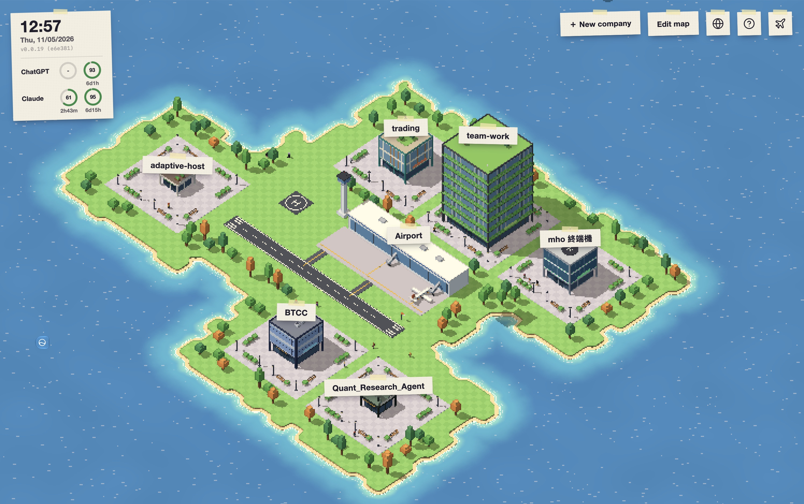

<p align="center">
  <a href="."></a>
</p>

<p align="center">
  <a href="README.md"></a>
  <a href="README-tw.md"></a>
  <a href="README-cn.md"></a>
  <a href="README-ja.md"></a>
  <a href="README-ko.md"></a>
</p>

# Team Work

Team Work 是一個 macOS App，讓一群 AI Agent 在你自己的專案裡工作。每個專案是像素風小島上的一間公司，公司的員工是 AI Agent，他們照著任務藍圖一步步完成工作，每個任務都在自己的 Git 分支上進行，最後由你審核並合併。



## 主打特色

- **技能從 GitHub 自動更新**：貼上 GitHub Repo 就能用裡面的技能，不用自己一個個複製檔案。Repo 出新版時按一下就能套用，也可以打開「自動套用」。直接就能用 Matt Pocock 的技能和 poteto 的 pstack。
- **一個專案就是一間公司**：每間公司有自己的設定、員工和任務，專案之間互不干擾。
- **每位員工各有專長**：員工可以設定不同的技能、Prompt、可用工具和模型，讓每個角色專心做好自己的事。
- **多位員工一起對話**：把不同模型、不同專長的員工拉進同一個對話，一起討論、修改和建立需求。
- **App 的功能都能交給 AI**：在對話裡請員工幫你建立或修改任務、員工藍圖、任務藍圖和模型供應商，改藍圖和供應商前會先等你同意。員工也看得到 App 裡的終端機。
- **App 裡就有終端機**：所以可以直接在 App 裡用 Codex、Claude Code。
- **支援 GPT 和 Claude 訂閱**：用 ChatGPT 或 Claude 訂閱登入，還能直接看到剩下多少額度。
- **省 Token**：員工平常只看技能清單，需要時才讀完整內容；長對話會自動把前面的內容摘要；步驟之間用精簡的交接傳遞工作；模型供應商支援時，重複的 Prompt 會被快取。

## 即將推出

從 GitHub 載入、更新別人分享的內容：

- [x] 技能
- [ ] 員工藍圖
- [ ] 任務藍圖

## 功能

- **基地台**：透過內建的 [Tailcat](https://github.com/tailscale/tailcat/) 配對自己的電腦，前往對方的島。首次配對須經同意，每台各自設定是否允許對方操作。工作和設定都留在對方電腦，控制端斷線也不影響任務。**被操作的那台必須保持 Team Work 開啟。** 不需 Tailscale 帳號或額外安裝，預設免費中繼站有流量限制。
- **移民署**：機場旁的固定建築，放全島共用的員工。每間公司都能直接挑他們工作，用的是那間公司的資料夾、規則和權限。員工可在公司和移民署之間移動（記憶清空），也能從配對電腦的島上複製員工到這台的移民署。
- **公司**：一個專案資料夾和一個目標分支就是一間公司。公司完成越多任務、員工越多，大樓就長得越大。
- **員工**：由藍圖（Prompt、技能和允許的工具）產生，每位員工各自選模型和思考等級。也可以不用藍圖，替員工自訂 Prompt、技能和工具，或複製藍圖後再微調。內建 13 個藍圖，例如後端工程師、審查與測試、媒體設計師，以及照 GitHub 上公開技能工作的 Matt Pocock 和 Poteto。
- **任務藍圖**：任務要經過的步驟，從「整理需求」開始、以「驗收」結束。中間的步驟可以交給員工執行工作，或和你討論。現成有 4 條任務藍圖：一般任務、功能開發、修 Bug、程式審查。它們和現成的員工藍圖都放在官方來源 [Team-Work-Source](https://github.com/yanun0323/Team-Work-Source)，第一次使用時下載，之後自動更新。
- **任務**：每個任務在自己的 Git work tree 和 `task/編號` 分支上進行。員工有問題時任務會等你回覆；驗收通過後，由你合併回目標分支或退回重做。負責人召集的會議和流程裡的討論步驟，直接在任務對話裡開，由負責人主持 1 到 6 位員工；與會者用 `@` 互相點名接力；你可以隨時插話引導、用 `@` 指定員工回答或請任務的其他員工加入，結束後留下負責人的結論。
  - 工作步驟開始前，會自動替有鎖定檔的 npm／pnpm／Yarn 專案準備套件。版本相符且不連回主資料夾的 npm 套件會複製到任務 worktree（可用時採 APFS 快速複製）；其他情況由套件管理器依鎖定檔安裝，也會執行正常的安裝腳本。後續步驟沿用環境，套件設定改變時重新準備。電腦須已安裝 Node 與對應套件管理器。準備進度顯示於任務紀錄；失敗時停止工作與驗證，讓你重試。不需建立 `.worktreeinclude`，不會複製 `.env`、其他私人檔案或其他語言環境。套件產物須在任務分支被 Git 忽略。
- **對話**：在專案資料夾裡和員工聊天。輸入 `$` 選技能，輸入 `#` 提及檔案。選多位員工或用 `@` 提及員工，就能開會。
- **模型供應商**：Anthropic、OpenAI、Google Gemini 和任何 OpenAI 相容 API，也可以用 Claude 或 ChatGPT 訂閱登入。
- **技能**：藍圖可以從本機資料夾或 GitHub repo 載入技能。
- **終端機**：每間公司都有一個開在專案資料夾的 zsh 終端機，機場也有一個開在家目錄的。
- **檔案瀏覽**：瀏覽公司的專案資料夾，編輯文字檔、預覽圖片。
- **語言**：繁體中文、簡體中文、英文、日文和韓文。

## 安裝

1. 從 [Releases](https://github.com/yanun0323/Team-Work/releases) 下載 `Team-Work-macOS.zip`。
2. 解壓縮後，把 `Team Work.app` 移到「應用程式」資料夾。

需要 macOS 13.3 以上，支援 Apple Silicon 和 Intel。App 需要 Git：Mac 上沒有的話，App 會停下來，等你安裝 Apple 的 Command Line Tools（裡面就有 Git），並可以直接開始安裝。專案資料夾還不是 Git repo 的話，建立公司時會自動初始化。

## 開始使用

1. 在「機場 → 模型供應商」至少新增一個供應商，員工才有模型可用。
2. 按「＋ 新公司」，在地圖上選位置，再填專案位置、名稱和目標分支。
3. 在公司的「員工」頁籤新增員工：選一個藍圖和模型。
4. 在「任務」頁籤建立任務：寫下要做的事、選任務藍圖，再為每一步選員工。
5. 打開任務看「進度」，有紅色驚嘆號的步驟正在等你回覆。

右上角的問號會打開完整的使用說明。

## 資料與安全

- 資料存在 `~/.team-work`。要改用其他資料夾，把 `TEAM_WORK_HOME` 設成絕對路徑。
- API Key 和登入憑證存在 `data.db`，檔案權限是 `0600`，沒有加密。
- 執行指令沒有沙盒，只在信任的藍圖裡允許「執行指令」工具。

## 從原始碼建置

需要 Go（版本見 `backend/go.mod`）、Node.js 和 npm，以及 Xcode 命令列工具。

```sh
make dev           # 同時啟動後端和前端，開在 http://localhost:5173
make dev-mock      # 只啟動前端，使用模擬資料
make test-backend  # 後端測試
make build         # 建置 dist/Team Work.app（未簽署）
```

執行 `make help` 可列出所有指令。更多細節見[後端說明](backend/README.md)和[前端說明](frontend/README.md)。

## 授權

[Apache License 2.0](LICENSE)
