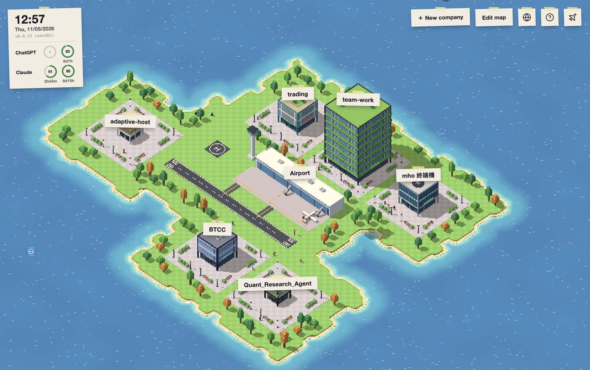

<p align="center">
  <a href="."></a>
</p>

<p align="center">
  <a href="README.md"></a>
  <a href="README-tw.md"></a>
  <a href="README-cn.md"></a>
  <a href="README-ja.md"></a>
  <a href="README-ko.md"></a>
</p>

# Team Work

Team Work is a Mac app that lets a team of AI employees work on your own projects. Each project is a company on a small pixel-art island. You hire employees, hand them a task, and they work through it step by step. Every task runs on its own Git branch, so nothing reaches your code until you look it over and merge it.



## Highlights

- **One project, one company**: each company has its own employees, tasks, rules and memory, so projects never get mixed up.
- **Employees with a specialty**: each employee works from a blueprint, which holds the instructions, skills and tools for one job, and uses the model you pick. 12 blueprints are ready to use.
- **Several employees in one chat**: bring employees on different models into one chat to talk an idea through. The last one to reply can hand the next step to a colleague.
- **Use your subscriptions**: sign in with ChatGPT or Claude instead of paying per use, and see how much is left at a glance.
- **Skills, blueprints and workflows from GitHub**: paste a GitHub repo and use what is in it, with no files to copy. When the repo changes, update with one click or let it update by itself. Matt Pocock's skills and poteto's pstack are ready to use.
- **Employees can run the app for you**: ask in a chat and an employee sets up tasks, blueprints, workflows and model providers. Changes to existing settings wait for your OK.
- **Uses fewer tokens**: employees read a skill only when they need it, long chats are summed up, steps pass work on with short notes, and repeated prompts are cached when the provider allows it.

## Features

- **Companies**: one project folder and one target branch (where finished work is merged) make a company. Its building grows as it finishes tasks and hires people.
- **Employees**: pick a blueprint, a model and how hard it thinks. You can also skip the blueprint and write their settings yourself. The 12 official blueprints are Generalist, Feature Planner, General-purpose Engineer, Researcher, Writer, Media Designer, UI Design Engineer, Review & QA, Frontend Engineer, Backend Engineer, SRE Engineer and Poteto. General-purpose Engineer works by Matt Pocock's skills and Poteto by poteto's. To move everyone off a model at once, pick it in Settings and choose the new one.
- **Workflows**: the steps a task goes through, from sorting out what is needed to the final check. A step is either work for one employee or a talk with you. Four are ready to use: General task, Feature development, Bug fix and Code review. They and the official blueprints come from [Team-Work-Source](https://github.com/yanun0323/Team-Work-Source), downloaded on first use and kept up to date.
- **Tasks**: each task works in its own copy of the project on a `task/<number>` branch. When an employee has a question, the task waits for you. When the work is done, you merge it or send it back. Commits use your own Git name and email. The task's owner can call a meeting with 1 to 6 employees right in the task chat; you can jump in at any time and `@` someone to bring them in.
  - A new task is ready to run: its copy also gets the files Git ignores, such as `.env` and local settings, and Node projects with a lockfile (npm, pnpm or Yarn) get their packages installed before work starts. Node and the package manager must already be installed. A copied `.env` still points at the same databases and services.
- **Chats**: talk with employees in the project folder. Type `$` to pick a skill, `#` to mention a file, and `@` to bring in another employee. Pictures an employee opens show up in the chat.
- **Memory**: company memory keeps a project's habits and pitfalls, shared by everyone who works there, and you can edit it on the company's Memory tab. Each employee also has their own memory of how they like to work, which goes with them to any company.
- **Immigration Office**: a building by the airport for employees the whole island shares. Any company can use them, with that company's folder and rules.
- **Cell Tower**: pair with your other Macs and visit each other's islands. For each friend island, choose Closed, View only or Can operate. The work runs on the other Mac, which must keep Team Work open. It uses the built-in [Tailcat](https://github.com/tailscale/tailcat/), so you need no Tailscale account or extra install; the free default relay has traffic limits.
- **Model providers**: Anthropic, OpenAI, Google Gemini and any OpenAI-compatible service (such as DeepSeek or a local Ollama), with an API key, or a Claude or ChatGPT subscription. A Claude subscription runs through Claude Code, which the app offers to install.
- **MCP and hooks**: list MCP servers in `~/.team-work/mcp.json` to give employees more tools, and run your own commands while they work with `~/.team-work/hooks.json`. Both use Claude Code's format, so you can copy entries over.
- **Image generation**: under Settings → System → Image generation, pick a ChatGPT subscription or an image model from an OpenAI-compatible provider, and employees can make pictures.
- **Semantic search (experimental)**: employees find code by what it does, not only by the words in it. It runs on your Mac, needs macOS 27 on Apple silicon, and is off until you turn it on in Settings.
- **Terminal and files**: each company has a terminal in its project folder, and the airport has one in your home folder, so you can use Codex or Claude Code without leaving the app. You can also browse the project, edit text files and preview images.
- **You on the island**: make your own character, see your stats, and walk around with W, A, S and D. Closing the window keeps the app running in the menu bar.
- **Languages**: Traditional Chinese, Simplified Chinese, English, Japanese and Korean.

## Installation

1. Download `Team-Work-macOS.zip` from [Releases](https://github.com/yanun0323/Team-Work/releases).
2. Unzip it and move `Team Work.app` to Applications.

You need macOS 13.3 or later, on Apple silicon or Intel. The app also needs Git: if your Mac does not have it, the app offers to install Apple's Command Line Tools, which include it. A project folder that is not a Git repo yet becomes one when you create its company. The app updates itself.

## Getting Started

1. In Airport → Model providers, add at least one provider so employees have a model to use.
2. Press ＋ New company, pick a spot on the map, then fill in the project folder, name and target branch.
3. On the company's Employees tab, add employees: pick a blueprint and a model.
4. On the Tasks tab, create a task: describe the work, pick a workflow and choose who does each step.
5. Open the task and watch Progress. A step with a red exclamation mark is waiting for you.

The question mark at the top right opens the full guide.

## Data and Security

- Everything is kept in `~/.team-work`. To use another folder, set `TEAM_WORK_HOME` to an absolute path.
- API keys and sign-ins are kept in `data.db`, readable only by your user account (`0600`). They are not encrypted.
- Employees who may run commands can reach your whole computer; there is no sandbox. Give that tool only to blueprints you trust.

## Build from Source

You need Go (version in `backend/go.mod`), Node.js with npm, and Xcode's command line tools.

```sh
make dev           # backend and frontend together at http://localhost:5173
make dev-mock      # frontend only, with made-up data
make test-backend  # backend tests
make build         # build dist/Team Work.app (unsigned)
```

Run `make help` to see every command. The [backend](backend/README.md) and [frontend](frontend/README.md) notes are in Traditional Chinese.

## License

[Apache License 2.0](LICENSE)
