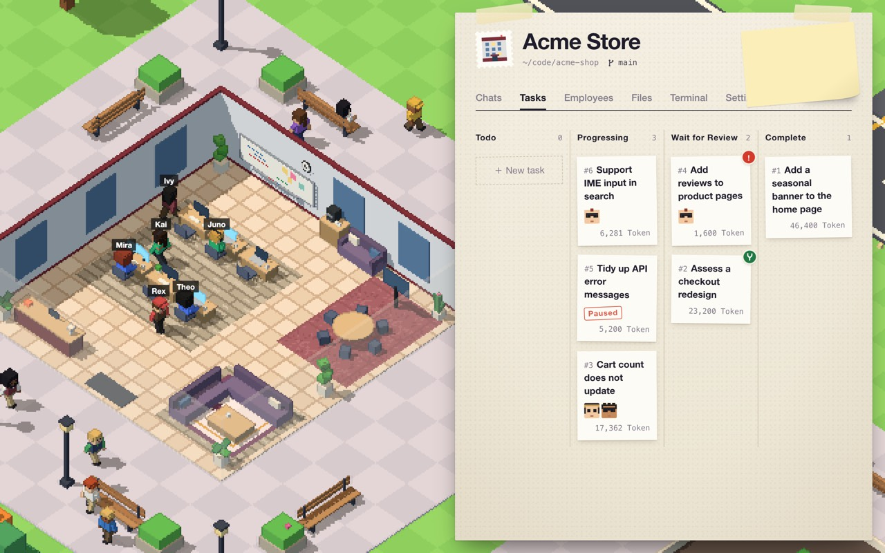

<p align="center">
  <a href="."></a>
</p>

<p align="center">
  <a href="README.md"></a>
  <a href="README-tw.md"></a>
  <a href="README-cn.md"></a>
  <a href="README-ja.md"></a>
  <a href="README-ko.md"></a>
</p>

# Team Work

Team Work is a macOS app that runs a team of AI agents on your own projects. Each project is a company in a building on a pixel-art island. Its employees are AI agents who follow a workflow step by step, each step in its own Git branch, and you review and merge the result.



## Features

- **Companies**: one company per project folder and target branch. The building grows as the company finishes tasks and hires employees.
- **Employees**: made from blueprints (prompt, skills and allowed tools). Each employee picks their own model and thinking level. There are 16 built-in blueprints, such as Backend Engineer, Code Reviewer and Technical Writer.
- **Workflows**: the steps a task goes through, from Clarify requirements to Acceptance review. Steps can hand work to an employee or open a discussion with you. Six workflows are built in, including Feature development, Bug fix and Refactor.
- **Tasks**: each task works in its own Git worktree on a `task/<number>` branch. When an employee has a question, the task waits for your reply. When the work passes review, you merge it into the target branch or send it back.
- **Chats**: talk with an employee in the project folder. Type `$` to pick a skill and `@` to mention a file.
- **Model providers**: Anthropic, OpenAI, Google Gemini and any OpenAI-compatible API. You can also sign in with a Claude or ChatGPT subscription.
- **Skills**: blueprints load skills from local folders or GitHub repos.
- **Terminal**: each company has a zsh terminal in its project folder.
- **Languages**: Traditional Chinese and English.

## Installation

1. Download `Team-Work-macOS.zip` from [Releases](https://github.com/yanun0323/Team-Work/releases).
2. Unzip it and move `Team Work.app` to Applications.

The app needs macOS 12 or later and runs on Apple Silicon and Intel. Tasks need Git and a project folder that is a Git repo.

## Getting Started

1. In Airport → Model providers, add at least one provider so employees have models to use.
2. Press ＋ New company, pick a spot on the map, then fill in the project folder, name and target branch.
3. On the company's Employees tab, add employees: pick a blueprint and a model.
4. On the Tasks tab, create a task: describe the work, pick a workflow, and choose employees for each step.
5. Open the task and watch Progress. A step with a red exclamation mark is waiting for you.

The question mark at the top right opens the full guide.

## Data and Security

- Data is stored in `~/.team-work`. Set `TEAM_WORK_HOME` to an absolute path to use another folder.
- API keys and sign-in tokens are kept in `data.db` with file permission `0600`. They are not encrypted.
- Running commands has no sandbox. Allow the run commands tool only in blueprints you trust.

## Build from Source

You need Go (see `backend/go.mod` for the version), Node.js with npm, and the Xcode command line tools.

```sh
make dev           # backend and frontend together at http://localhost:5173
make dev-mock      # frontend only, with simulated data
make test-backend  # backend tests
make build         # build dist/Team Work.app (unsigned)
```

Run `make help` to list every command. The [backend](backend/README.md) and [frontend](frontend/README.md) notes are in Traditional Chinese.

## License

[Apache License 2.0](LICENSE)
